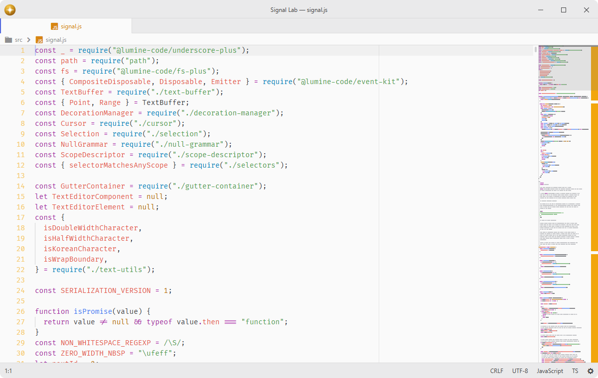

# minimap

A preview of the full source code.

## Features

- **Canvas rendering**: incremental redraws — only the row ranges that changed are repainted.
- **Syntax highlighting**: token colors are resolved directly from the active theme via computed DOM styles and cached per scope, so the minimap matches the editor exactly.
- **Scroll past end**: the minimap proportionally tracks the full editor scroll range, including the scroll-past-end zone.
- **Marker layers**: git changes, linter messages, search hits and more are drawn over the code — enabled in the `marker` package, computed once and shared with the scrollbar strip through `marker.registry`.
- **Independent scroll**: optionally decouple mouse-wheel scrolling on the minimap from the editor.



## Installation

To install `minimap` search for it in the Install pane of the Lumine settings, or run the command `lumine --install lumine-code/minimap`.

## Commands

Commands available in `lumine-workspace`:

- `minimap:toggle`: show or hide the minimap in all text editors.

## Customization

The appearance can be adjusted in the user stylesheet, e.g. hide the editor scrollbar next to the minimap, tint the minimap background, and recolor the visible-area overlay:

```css
lumine-text-editor[with-minimap] .vertical-scrollbar {
  display: none;
}

lumine-text-editor lumine-text-editor-minimap {
  background: var(--app-background-color);

  .minimap-visible-area::after {
    background-color: rgba(127, 127, 127, 0.35);
  }

  .minimap-markers .marker {
    opacity: 0.5;
  }
}
```

Marker layers style their own colours; the widths above are the minimap's, so narrowing a layer that feels too wide here is a change to `.minimap-markers .marker`, not to the layer package.

## Services

- `marker.registry`: consumed to read every editor's computed marker layers and the toolkit that draws them.

## Contributing

Got ideas to make this package better, found a bug, or want to help add new features? Just drop your thoughts on GitHub. Any feedback is welcome!
